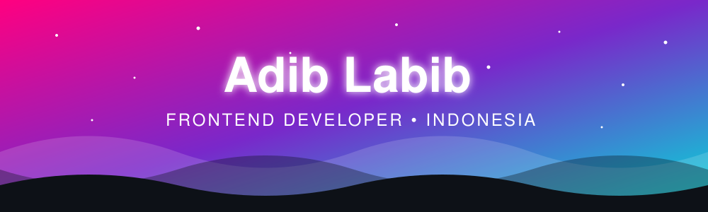

<!-- ===== HEADER ===== -->

  

- 🎨 Frontend developer who loves crafting smooth, good-looking UIs
- 🌱 Currently exploring **React, TypeScript & Next.js**
- 🧪 Also tinkering with **Python, Java, C++ & a bit of AI / Computer Vision**
- 🎮 Side interests: **Blender, Unity & design (Figma / Illustrator)**
- 💬 Ask me about anything frontend-related!

<!-- Ganti USERNAME_KAMU dengan username/link asli kamu -->

 

 

  

 

 

  

